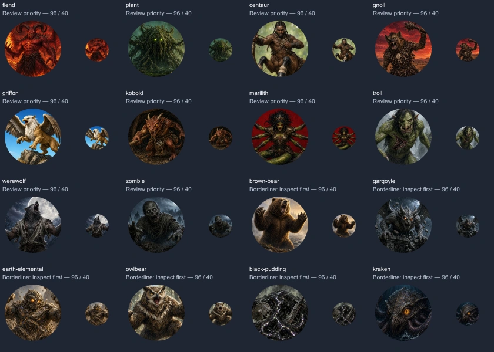

# ODM token readability — Grok follow-up from Codex

Reviewed 11 October 2026 against #245 at
`f0925661560383bbee9b875f57a0657ca3d75ef0` and #246 at
`76ee582336ad1a3291a786b1fcc616dadcaf1ec5`.

This is a visual review of **208 distinct tiles**: the 53 Grok-selected monster,
NPC and character tiles from the original vote, plus 155 new tiles from the
#242/#244/#245 stack. It is not a code, licensing or anatomy audit. Previews used
96px and 40px round masks. Findings are visual judgments, not automated scores.

## Eight repaints pass

The updated celestial, giant, undead, steampunk-automaton, horror-flesh-thing,
horror-revenant, fey and dragon in #246 all retain a clear primary face/feature
at 40px. Keep those repaints; this review does not request another iteration.

## Prioritize these ten for another look

All paths are `public/assets/placeholders/monster/<id>.webp`.

| Tile | Observed problem at 40px | Suggested change |
| --- | --- | --- |
| fiend | The original red full-body figure and fiery background merge; head is tiny. | Large horned head and shoulders against cooler dark contrast. |
| plant | Dark tangled vegetation merges into the background; the eyes are small pinpoints. | Enlarge a defining plant head/maw and separate its silhouette. |
| centaur | The whole body and weapon shrink the human head to a few pixels. | Upper torso/head with a small equine cue; keep a separate full-body illustration if needed. |
| gnoll | Raised weapon, torso and scenery dominate the small face. | Tight hyena head and shoulder portrait. |
| griffon | Wings, whole body and rock consume the circle; beak/head becomes tiny. | Eagle head, mane and one wing-root cue. |
| kobold | Crouched body, equipment and dark surroundings obscure the small head. | Large reptilian face, ears/horns and one equipment cue. |
| marilith | All arms, swords and tail compete with a very small central face. | Larger face and upper torso, with a few arm/sword roots suggesting the anatomy. |
| troll | Long torso and reaching limbs reduce the face and blend into the background. | Tight distinctive troll face and shoulders. |
| werewolf | Upturned howling head and upper body do not give a clear face in the circle. | Larger three-quarter wolf face with visible eyes and muzzle. |
| zombie | Body, arms and scenery leave a small dark head with weak separation. | Close-up corpse face and shoulders with a contrasting backdrop. |

## Borderline: inspect before commissioning anything

- **brown-bear, gargoyle, earth-elemental, owlbear:** recognizable broad bodies,
  but the head is still relatively small. A crop/edit may be enough if the face
  needs to carry identity; do not automatically repaint all four.
- **black-pudding, kraken:** the subject fills the frame, but low contrast can
  hide its structure at 40px. Try clearer value separation before changing the
  composition.

Human portraits generally remain recognizable as people. Some older portraits
could be tighter, but this pass does not establish that every such portrait
needs replacing. Multiheaded and swarm pictures can pass without a single huge
face when the cluster itself is clear. For example, the giant-scorpion's curved
tail is a readable identifying feature despite its wider view.

Keep existing paths, approved identities and palette. Check the shipped WebP in
round 96px and 40px previews before submitting. Only change failures confirmed
against the current files; another branch may already have addressed them.

Local evidence: `token-art-pass/grok-review-1.png` through `grok-review-6.png`
and `grok-reviewed-keys.json` in the shared ODM 2 workspace. These local sheets
are review evidence, not additional shipped app assets.

