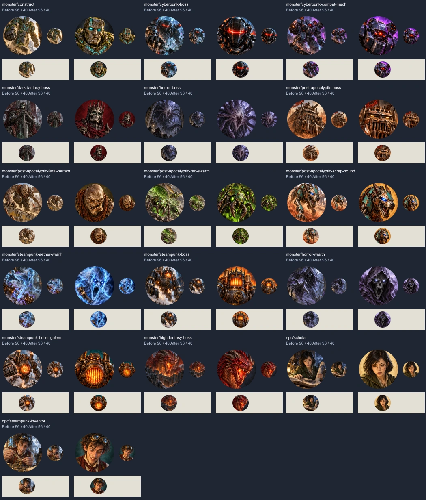
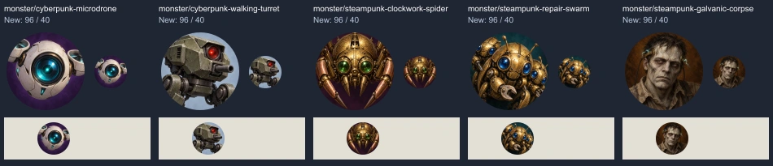

# Artwork for small board tokens

Monster, NPC and character pictures also appear as round battle-board tokens.
Review the final shipped WebP in a circular crop at **96px and 40px**, on both
dark and light surrounds. A detailed square illustration can still fail here.

## Compose for the circle

- Let the head, upper shoulders or defining machine/creature feature occupy
  about 80% of the frame. Keep eyes and the identifying feature inside the
  central circle. Check the result rather than treating the percentage as a
  mechanically measured score.
- Prefer a simple contrasting background, a clear silhouette and broad shapes.
  Remove scenery, distant bodies, foreground props and fine texture that compete
  with the subject. Keep one useful role cue, such as goggles or a crown.
- For a swarm, use a few large overlapping subjects. For a vehicle, use its
  recognizable front or machinery. Do not force every subject into a human face.
- Ship a full square image. The app applies the round crop; do not paint a
  circular border or mask into the file.
- Preserve the approved subject, identity and palette when improving framing.
  Reuse art that already reads well. A model assignment is not a repaint order.

## File and review requirements

Use 512x512 WebP at the existing path when repainting a tile. New subjects need
an entry in the placeholder job list, manifest and runtime lookup. Keep genre
subjects confined to their genre, and avoid broad stat-block aliases when the
same stats can represent a visually different creature.

Keep each painted square under the existing 128 KiB limit and check the complete
set with `node scripts/test-placeholders.mjs`. Account for other open art PRs
when checking the total budget. Preserve generation prompts, original and final
hashes, encoding settings, and the review previews. Keep historical vote records
unchanged: a repaint has not received its predecessor's votes.

Use original designs with a recorded subject basis. Do not copy official art or
let generic aberration prompts introduce a beholder or mind flayer. Repainting
for readability does not remove the need for the project's creature-source check.

## Codex pass, 11 October 2026

This pass repaints the 13 assigned tiles plus all three reviewed borderline
tiles: horror-wraith, steampunk-boiler-golem and high-fantasy-boss. It adds the
five subjects left in Codex's backlog: surveillance microdrone, walking turret,
clockwork spider, repair swarm and galvanic corpse. Other approved art is kept.

The new entries match complete names within cyberpunk or steampunk. Spy
Microdrone and Galvanic Revenant now receive their intended pictures. Ordinary
imps, spiders, zombies and ghosts keep their existing selection behavior.

The [provenance record](codex-token-readability-2026-10-11.json) contains the
prompts, original and final hashes, dimensions and encoding settings. Images
were generated with Codex's built-in image tool, then resized and encoded once
to WebP quality 90. All 21 final tiles were visually inspected at 96px and 40px.

### Repaints: before and after

Each pair shows 96px and 40px circles, followed by a 40px view on a light surround.

### Five new subjects

These sheets display exact pixel sizes at their native resolution. Open the
image at 100% rather than enlarging it to judge small-token readability.

This branch follows Grok's #245 stack (#242, then #244, then #245). Grok's #246
changes eight different files. The aboleth replacements remain in #236.

The separate [Grok follow-up review](grok-token-readability-follow-up.md) records
possible missed tiles; those findings are not permission to redo the whole set.
